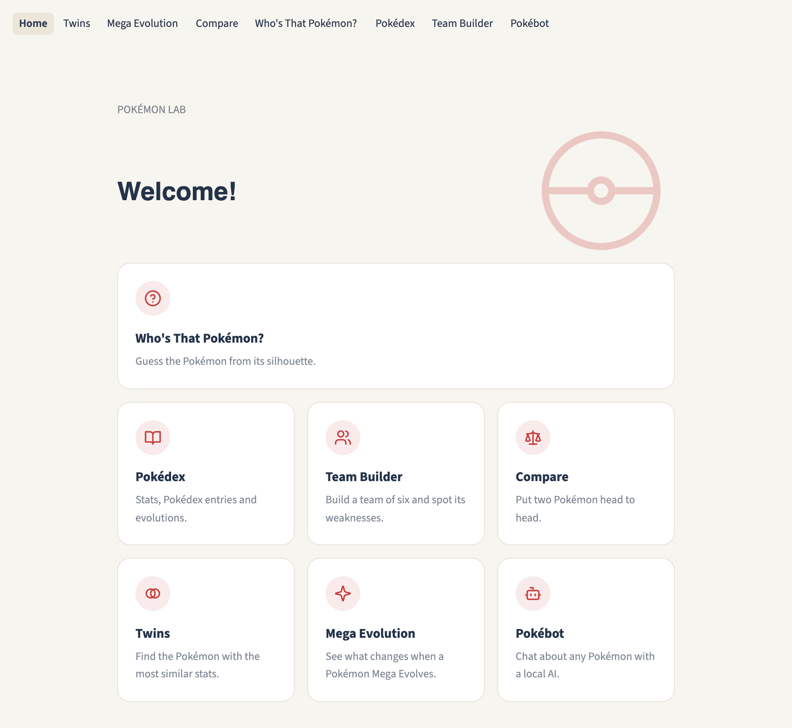
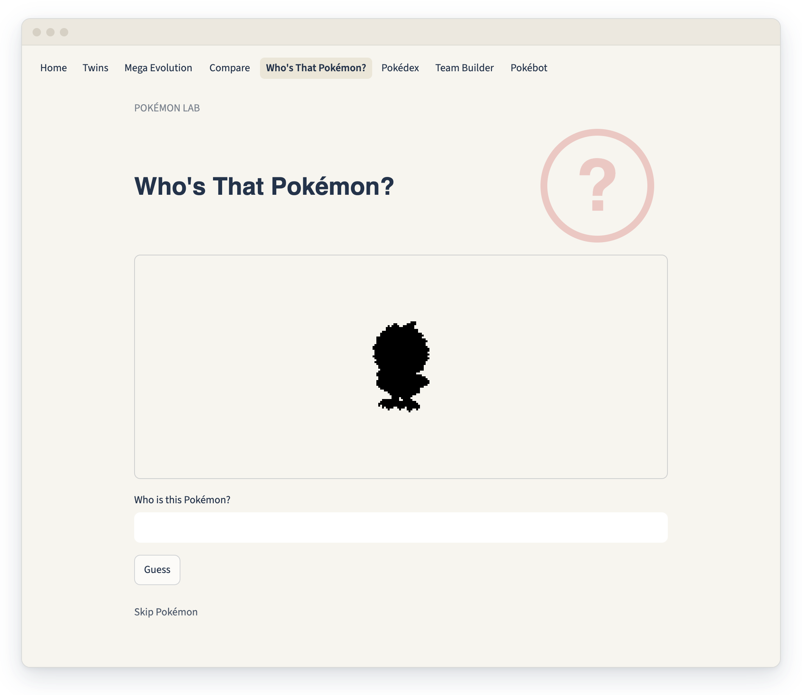
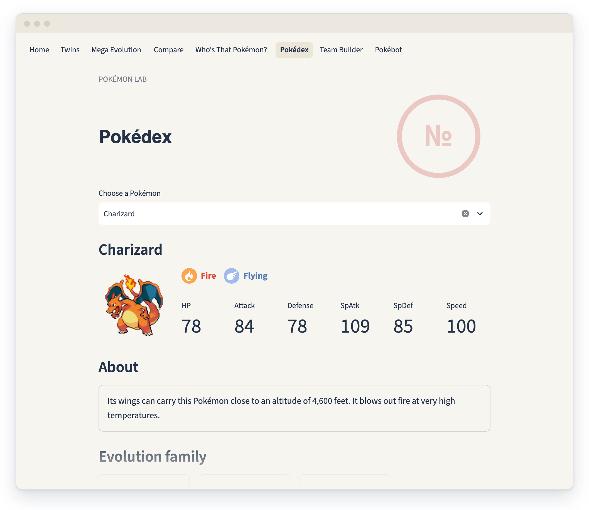
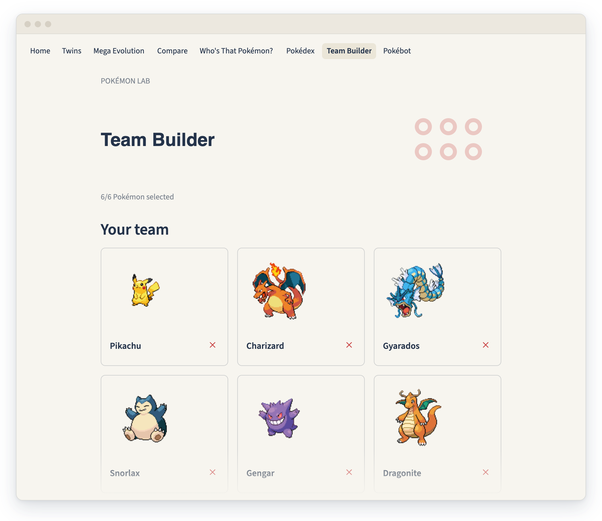
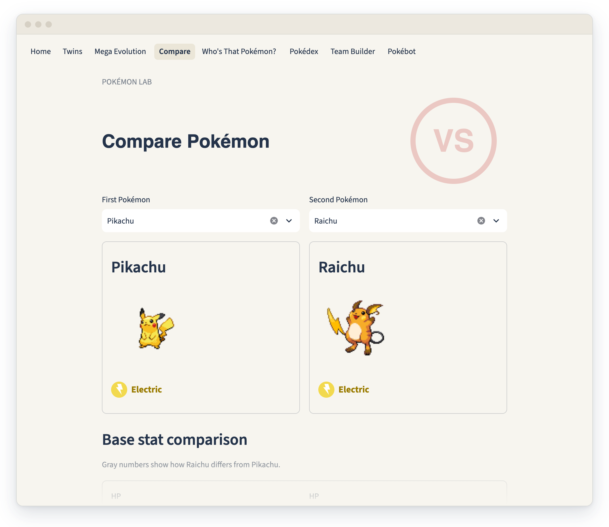

<h1 align="center">Pokémon Lab</h1>

<p align="center">
  A playful web app for exploring Pokémon from generation 1–6.<br>
  Guess silhouettes, browse the Pokédex, build a team and compare stats.
</p>

<p align="center">
  
  
  
</p>

<p align="center">
  <a href="https://pokemon-lab.streamlit.app/">
    
  </a>
  <br>
  <b><a href="https://pokemon-lab.streamlit.app/">pokemon-lab.streamlit.app</a></b>
</p>

<p align="center">
  
</p>

## Features

<table>
  <tr>
    <td width="50%" valign="top">
      
      <h3>Who's That Pokémon?</h3>
      <p>Guess the silhouette. Every wrong guess unlocks a new hint.</p>
    </td>
    <td width="50%" valign="top">
      
      <h3>Pokédex</h3>
      <p>Stats, Pokédex entries, evolutions and Mega forms in one place.</p>
    </td>
  </tr>
  <tr>
    <td width="50%" valign="top">
      
      <h3>Team Builder</h3>
      <p>Pick six Pokémon and find the types your team is weak against.</p>
    </td>
    <td width="50%" valign="top">
      
      <h3>Compare</h3>
      <p>Put two Pokémon side by side and see who wins each stat.</p>
    </td>
  </tr>
</table>

<p align="center">
  Also included: <b>Twins</b> (most similar stats), <b>Mega Evolution</b> and <b>Pokébot</b> (local AI chat).
</p>

## How it works

- **Data cleaning:** `pipeline.ipynb` turns the raw CSV into clean names
  (`VenusaurMega Venusaur` → `Mega Venusaur`, broken characters like `Nidoran♀` → `Nidoran♀`)
  and matches special forms to their PokeAPI sprite IDs.
- **Twins:** the distance between two Pokémon is the sum of the differences in their six base stats.
- **Team weaknesses:** type matchups come from PokeAPI and are multiplied per type, so a
  Grass/Ground Pokémon takes 4× damage from Ice.
- **Pokébot:** runs `qwen3:1.7b` locally through [Ollama](https://ollama.com). The model only gets
  the Pokémon's stats and types, so it is told to say when it does not know something.

## Run it locally

The quickest way to try it is the [live app](https://pokemon-lab.streamlit.app/).
To run it on your own computer:

```bash
pip install -r requirements.txt
streamlit run app.py
```

Pokébot also needs Ollama with the model downloaded (`ollama pull qwen3:1.7b`).
All other pages work without it.

Run the tests with:

```bash
pip install pytest
python3 -m pytest
```

## Project structure

```
app.py            navigation between the pages
pages/            one file per page
shared/           data, layout, type icons, AI helper
data/             raw and cleaned CSV
pipeline.ipynb    data cleaning
tests/            tests for the shared helpers
docs/screenshots/ images for this README
```

## Credits

- Sprites, Pokédex entries, evolutions and type matchups: [PokeAPI](https://pokeapi.co)
- Type symbols: [duiker101/pokemon-type-svg-icons](https://github.com/duiker101/pokemon-type-svg-icons)
- Home page icons drawn in the style of [Lucide](https://lucide.dev)

<sub>Fan project, not affiliated with Nintendo, Game Freak or The Pokémon Company.
Pokémon and Pokémon names are trademarks of their respective owners.</sub>
